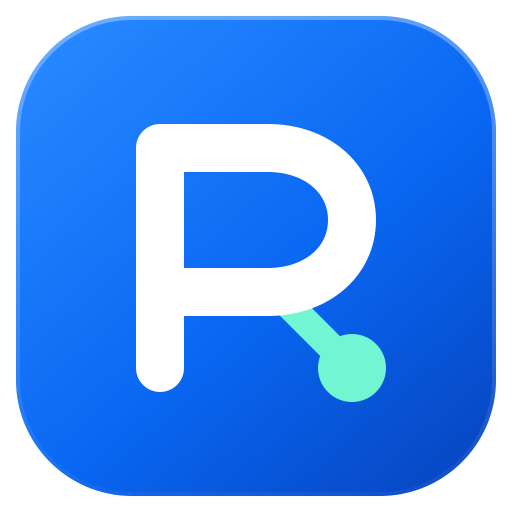
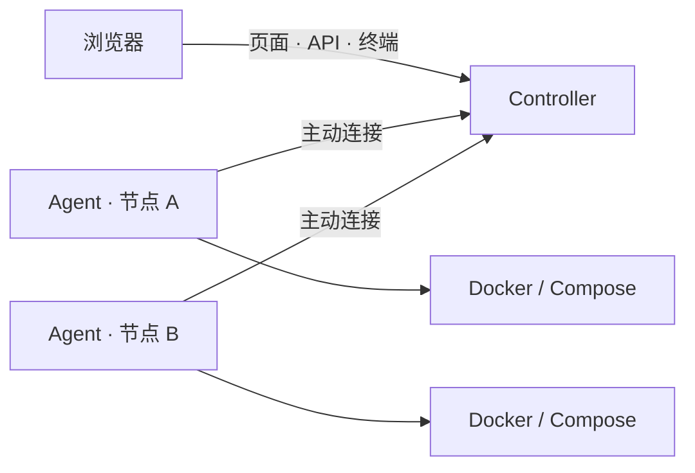

<div align="center">
  
  <h1>Poke</h1>
  <p><strong>一处管理，连接每一个 Docker 节点。</strong></p>
  <p>轻量的 Docker 与 Compose 可视化管理工具<br />从一台主机到多个节点，在浏览器中管理容器、部署项目、打开终端。</p>
  <p>
    <a href="https://github.com/a1zaza/poke/actions/workflows/docker.yml"></a>
    <a href="https://github.com/a1zaza/poke/pkgs/container/poke"></a>
    
    <a href="server/go.mod"></a>
    <a href="package.json"></a>
  </p>
  <p>
    <a href="#快速部署">快速部署</a> ·
    <a href="docs/deployment.md">部署文档</a> ·
    <a href="docs/architecture.md">架构说明</a> ·
    <a href="docs/development.md">开发指南</a> ·
    <a href="https://github.com/a1zaza/poke/issues">问题反馈</a>
  </p>
</div>

---

## 为什么选择 Poke

- **统一管理**：在同一个界面切换本机与远程节点，管理 Docker 和 Compose。
- **主动连接**：Agent 主动连接 Controller，适用于 NAT 后的节点，无需开放 Agent 入站端口。
- **轻量部署**：前端嵌入 Go 二进制，页面、API 和终端由同一服务提供，默认端口 `80`。
- **简单持久化**：配置、身份和任务记录使用 JSON 保存，无需额外部署数据库。

## 功能一览

| | 能力 |
| --- | --- |
| 容器管理 | 创建、启停与删除容器，查看详情、日志，打开交互式终端 |
| Compose 项目 | 创建、编辑、部署、启停和更新项目 |
| 镜像与仓库 | 管理镜像、检查更新，配置仓库凭据和节点授权 |
| 网络与存储 | 查看和管理 Docker 网络、数据卷 |
| 多节点管理 | 节点注册、身份撤销、在线状态和远程任务查询 |
| 系统概览 | 查看节点资源使用情况与容器运行状态 |

## 工作方式



| 模式 | 适用场景 |
| --- | --- |
| `standalone` | 默认模式，直接管理本机 Docker |
| `controller` | 统一管理入口，接收 Agent 连接，默认无需本机 Docker |
| `agent` | 执行节点，在本机操作 Docker，不监听 HTTP 端口 |

Controller 可通过 `POKE_LOCAL_ENABLED=true` 同时管理本机 Docker。三种模式共用一个镜像。

## 快速部署

> 默认镜像：`ghcr.io/a1zaza/poke:latest`，支持 `linux/amd64` 和 `linux/arm64`。
> 管理入口使用 HTTPS；页面与 API 通过同一个来源访问。

### 1. 启动 Controller

下载 [compose.yaml](compose.yaml) 和 [.env.example](.env.example)，放到同一目录。将 `.env.example` 复制为 `.env`，按需设置 `POKE_IMAGE`，然后运行：

```bash
docker compose -f compose.yaml up -d
```

容器内 Web 端口为 `80`，外部端口按 Compose 映射访问。**首次启动生成的管理员密码会输出到服务日志。** HTTPS 入口和反向代理设置见[部署文档](docs/deployment.md)。

### 2. 接入 Agent

在 Controller 的系统设置中注册节点。在目标主机下载 [compose.agent.yaml](compose.agent.yaml) 和 [.env.example](.env.example)，复制为 `.env`，填写 Controller 的 HTTPS 地址、节点 ID 和注册凭据文件，再运行：

```bash
docker compose -f compose.agent.yaml up -d
```

Agent 需要可访问的 Docker 守护进程，挂载 `/poke:/poke` 和 Docker socket。项目、身份和任务统一保存在 `/poke` 下；注册凭据权限设为 `0600`，注册成功后按部署文档移除。Controller 与每个 Agent 使用独立的数据目录。

完整步骤、单机模式、私有 CA、自定义端口和备份方法见 **[部署文档 →](docs/deployment.md)**。

## 镜像版本

| 来源 | 标签 |
| --- | --- |
| 推送 `main` | `latest`、`sha-<完整提交 SHA>` |
| 推送 `v1.2.3` 等版本标签 | `v1.2.3`、`1.2.3`、`1.2`、SHA 标签 |
| Pull Request | 仅验证构建，不发布 |

建议部署时使用固定版本。原生 amd64、arm64 构建和发布由 [GitHub Actions](.github/workflows/docker.yml) 完成，不上传构建 artifact。GHCR 权限和手动发布方法见[开发指南](docs/development.md#自动发布)。

## 参与开发

前端使用 **Vue 3 + TypeScript + Vite**，后端使用 **Go + Echo + Docker SDK**。

准备 Node.js 24、Go 1.26.11 或更新补丁版本，以及可访问的 Docker 守护进程。安装前端依赖后，在两个终端中分别启动：

```bash
npm ci
npm run dev
```

```bash
cd server
PORT=3001 go run main.go
```

访问 `http://localhost:5173`，开发代理连接后端 `3001`。测试命令、目录结构和构建说明见[开发指南](docs/development.md)，节点协议与持久化设计见[架构说明](docs/architecture.md)。

欢迎通过 [Issues](https://github.com/a1zaza/poke/issues) 反馈问题或提出建议，提交问题时请附上运行模式、镜像版本和脱敏后的日志。

## 许可

仓库尚未附带 `LICENSE` 文件。
