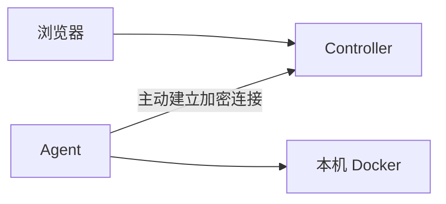

# 架构

## 运行模式

同一个 Go 程序和镜像支持三种模式：

- `standalone` 提供 Web 界面并管理本机 Docker。
- `controller` 提供统一管理入口、节点注册、授权和任务查询。默认不访问本机 Docker，可通过 `POKE_LOCAL_ENABLED=true` 启用。
- `agent` 执行本机 Docker 与 Compose 操作，主动连接 Controller，不监听 Web 端口。

浏览器使用管理员会话访问 Controller；Agent 使用独立机器身份。Controller 无需知道 Agent 的入站地址。

箭头表示连接建立方向。连接建立后，Controller 可以下发操作，Agent 返回结果。

## 注册与连接

管理员创建节点并选择允许使用的仓库，获得有效期 10 分钟的一次性注册凭据。Agent 先在本地保存注册尝试和随机秘密，再通过 HTTPS 提交注册；Controller 保存秘密的验证摘要。相同注册尝试可以安全重试。

Agent 保存独立身份后，通过 WSS 建立控制连接，校验协议版本并完成握手。心跳、退避重连和身份持久化支持普通进程重启。一个节点只保留一个当前控制会话；新连接替换旧连接。

调整仓库授权会断开当前连接，使后续请求按新授权执行。重新注册使旧身份失效；撤销节点关闭其全部管理连接并拒绝重连。

## 请求与数据通道

控制连接传递数据流邀请、任务、取消请求和结果确认。协议只允许既定的 Docker/Compose 资源操作，不接受任意目标 URL 或管理接口调用。

普通查询使用关联的数据连接返回 JSON。终端使用独立双向连接。所有 Agent 连接都从 Agent 主动发起，日志或终端数据不会占用控制连接。

连接具有消息大小、读写期限和并发数量限制。每连接串行写入，Ping/Pong 用于检测半开连接。浏览器断开或节点撤销时释放相应数据连接；终端输入不会在重连后自动重放。

## 修改任务

Controller 先持久记录任务，再下发给 Agent。Agent 落盘确认接收后执行，修改操作在单个 Agent 上串行处理，在途任务有数量上限。

任务 ID 用于投递去重。Agent 保存执行结果并向 Controller 报告，收到确认后标记已补报；连接恢复后补报未确认的终态结果。

取消执行是尽力而为。进程重启或执行中取消后，无法确定副作用的任务进入“结果待确认”，不会自动重放。任务失败也不表示 Docker 操作具有事务回滚能力。

本机管理采用进程内 API；远程 Agent 修改采用任务接口。系统不进行跨节点调度或 Controller 自动故障切换。

## 凭据与持久化

仓库凭据按节点授权及操作上下文提供，不写入任务记录。Docker SDK 与 Compose 共用凭据范围；Compose 解析项目镜像后生成临时私有 `DOCKER_CONFIG`，结束后清理。Agent 在持有角色独占锁后清理上次运行遗留的临时凭据。

节点、任务、配置和身份均使用 JSON。节点及注册状态在一个文件内更新，任务按 ID 分文件保存；进程互斥和目录锁保护并发更新。写入采用临时文件、同步、原子重命名及目录同步，私有文件权限为 `0600`。损坏文件会阻止启动。

运行中的容器由本机 Docker 维持，不依赖 Controller 在线。节点离线时无法接收新操作；恢复连接后对账已有任务结果。

## 代码边界

| 位置 | 职责 |
| --- | --- |
| `server/main.go` | 运行模式、服务装配和退出处理 |
| `server/internal/cluster` | 协议、Controller、Agent、节点与任务存储 |
| `server/api` | Docker/Compose 资源操作及进程内执行器 |
| `server/pkg/config` | 管理员认证信息、设置与仓库秘密 |
| `server/pkg/images` | 镜像检查及操作级仓库凭据 |
| `server/webui` | 嵌入资源、页面回退和动态 Logo |
| `src` | 管理页面、节点选择和任务请求 |

部署参数与数据文件路径见 [部署说明](deployment.md)，开发检查见 [开发说明](development.md)。
