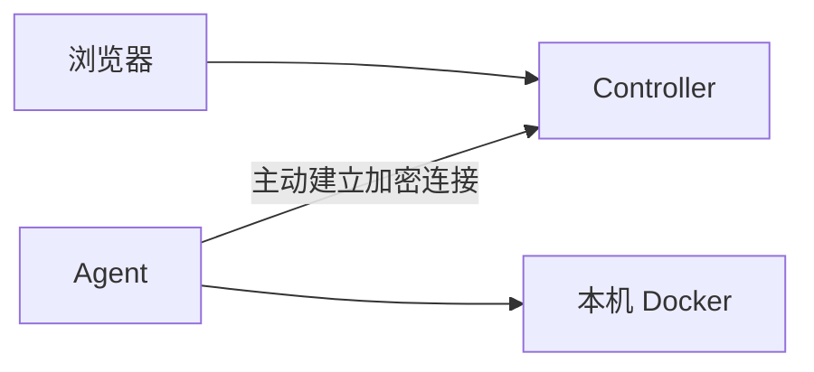

# 架构

## 运行模式

同一个 Go 程序和镜像支持三种模式：

- `standalone` 提供 Web 界面并管理本机 Docker。
- `controller` 提供统一管理入口、节点注册、授权和任务查询。默认不访问本机 Docker，可通过 `POKE_LOCAL_ENABLED=true` 启用。
- `agent` 执行本机 Docker 与 Compose 操作，主动连接 Controller，不监听 Web 端口。

浏览器使用管理员会话访问 Controller；Agent 使用独立机器身份。Controller 无需知道 Agent 的入站地址。

箭头表示连接建立方向。连接建立后，Controller 可以下发操作，Agent 返回结果。

## 节点身份与连接

管理员在“节点与任务”创建节点，获得稳定节点 ID 和仅展示一次的长期 Token。Agent 通过 `POKE_NODE_ID`、`POKE_NODE_TOKEN` 和 Controller 地址启动；Controller 只保存 Token 摘要。ID 与对应 Token 验证一致即为同一节点，不依赖客户端 IP，不自动创建重复节点，不保存 Agent 身份文件。轮换 Token 保留原节点和项目关联，旧 Token 拒绝后续连接。

Agent 主动建立 WSS 控制连接；协议版本为 2，不兼容旧节点协议及旧节点状态文件。每次启动生成内存 boot ID，每次连接由 Controller 分配会话 ID 和会话代数。相同进程可以重连，不同进程在有效租约内被拒绝，不能互相踢线。数据流票据绑定当前控制会话。

Controller 原子占用节点，并在 JSON 中保存租约所有者、会话代数及期限。心跳每 20 秒续租，Controller 租约为 60 秒；Agent 使用从请求发出时计算的保守期限，过期停止新修改并尽力取消执行。Controller 重启保留原租约，未知旧任务会阻止新修改。正常退出尝试报告结果并释放租约；异常退出需等待租约到期。

同一 ID/Token 不能作为并行 Agent 副本身份。Token 轮换、会话代数及租约不能中断已交给 Docker 的操作，结果不明时仍需对账。

## 请求与数据通道

控制连接传递数据流邀请、任务、取消请求和结果确认。协议只允许既定的 Docker/Compose 资源操作，不接受任意目标 URL 或管理接口调用。

普通查询使用关联的数据连接返回 JSON。终端使用独立双向连接。所有 Agent 连接都从 Agent 主动发起，日志或终端数据不会占用控制连接。

连接具有消息大小、读写期限和并发数量限制。每连接串行写入，Ping/Pong 用于检测半开连接。浏览器断开或节点撤销时释放相应数据连接；终端输入不会在重连后自动重放。

## 修改任务

Controller 保存任务、操作参数和项目版本后，Agent 仅在内存中排队。轮到执行时 Agent 准备固定操作、报告镜像域名及准备摘要，Controller 重新检查授权，先持久保存唯一执行许可，再下发许可和本次仓库认证。

单个 Agent 的修改串行执行，等待队列有上限。任务 ID、执行许可、启动标识和会话代数用于防重复。重复准备不产生第二份许可，重复执行消息不再次调用 Docker；已可能送达的许可不自动重新发送。

Agent 仅在内存保存结果，Controller 保存终态后确认。每次握手对账 Agent 内存中的待处理任务，未确认收到且未许可的任务取消，丢失已许可状态的任务转为待确认。同一进程重连可补报结果；Agent 新进程不能恢复原内存日志。租约到期且 Agent 不再重连时也会自动收敛任务，不会无限等待。Controller 重启时，尚未许可的任务取消，已许可且未结束的任务进入“结果待确认”，原进程仍可认证并补报相应结果。

不确定操作不自动重放，该节点暂停新修改。管理员需停止原执行实例、核实实际状态，再在“节点与任务”确认解除对应任务的阻塞。确认不会重试任务，也不会把未知结果改成成功。取消执行是尽力而为，不提供 Docker 事务回滚或跨进程严格一次执行。

## 配置与凭据归属

Controller 是节点、授权、任务和项目源配置的唯一持久化来源，全部使用 JSON。Agent 不初始化本地配置、身份或任务 Store；只查询 Docker、执行操作，在本机生成必要运行材料。Controller 项目按节点和项目隔离，保存稳定项目 ID、源配置版本和已部署版本。项目详情可在节点离线时显示源配置，并明确实际状态不可用。

外部 Compose 项目需显式导入源配置，导入不会立即修改 Docker。Agent 使用任务引用的源配置渲染固定快照，工作目录仍为 `/poke/projects/<项目>`；相对 bind mount 路径必须与宿主机一致。移除远程项目保留业务目录，只删除运行 Compose 文件及 Controller 中的有效项目记录（历史版本保留）。

首版远程项目只接受自包含 Compose：不支持 build、env_file、include、extends、label_file、develop，以及外部 configs/secrets 文件或宿主环境输入；不读取宿主环境插值，容器内变量使用 `$$` 转义。外部文件仍须由部署者在 Docker 主机管理。

仓库秘密只在 Controller 私有配置中持久化，不进入任务 JSON。普通查询、启停、删除和清理不携带认证；镜像操作按域名筛选，Compose 按固定配置和目标服务筛选，再与节点授权取交集。执行前读取最新凭据，Agent 操作上下文独立，禁止回退到其他节点的认证。

Docker SDK 使用内存认证；Compose CLI 生成私有临时 `DOCKER_CONFIG`，结束后清理，Agent Compose 部署将 `/tmp` 挂为 tmpfs，进程退出重建容器后不会保留认证。Agent 节点 Token 不传入 Compose 子进程环境。

Controller 写入采用私有权限、临时文件、同步、原子重命名及目录同步；目录锁防止多实例并写。损坏节点、任务或项目 JSON 阻止启动。Docker 的容器、镜像、业务文件及存储卷仍由执行主机持有，不随管理状态迁移到 Controller。

## 代码边界

| 位置 | 职责 |
| --- | --- |
| `server/main.go` | 运行模式、服务装配和退出处理 |
| `server/internal/cluster` | 协议、Controller、Agent、节点与任务存储 |
| `server/api` | Docker/Compose 资源操作及进程内执行器 |
| `server/pkg/config` | 管理员认证信息、设置与仓库秘密 |
| `server/pkg/images` | 镜像检查及操作级仓库凭据 |
| `server/webui` | 嵌入资源、页面回退和动态 Logo |
| `src` | 管理页面、节点选择和任务请求 |

部署参数与数据文件路径见 [部署说明](deployment.md)，开发检查见 [开发说明](development.md)。
